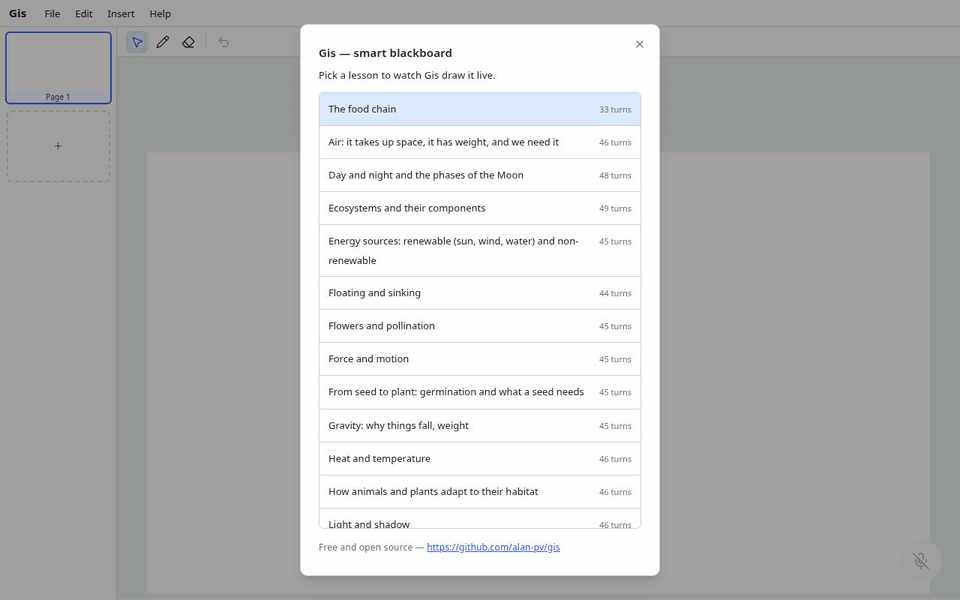

# Gis

**A smart blackboard that writes and draws while the teacher talks.**

[](https://github.com/alan-pv/gis/actions/workflows/ci.yml)
[](LICENSE)



## What is it?

Gis listens to a teacher explaining a topic and builds the board for them, live:
a title, sections, concepts in circles, arrows between ideas and bold keywords,
written progressively as if a hand were holding the chalk. It is made for
primary-school science, in English.

- **Talk, and the board writes itself.** No typing, no slides to prepare.
- **Structured like a real teacher's board.** The layout is inspired by *bansho*, the Japanese practice of planning the blackboard as the story of the lesson ([details](docs/BANSHO.md)).
- **Runs 100% on your computer.** No cloud AI model, no account, no subscription.
- **Free and open source** (MIT). No ads, ever.

## How it works

```
 Voice ──► Laya ──► gis-texto ──► Validator ──► Board
(browser)  decides   writes the    checks the    lays out and
           structure  words only   operations    animates it
```

The browser turns speech into text (Web Speech API). **Laya**, a small fine-tuned
model, decides what the board needs for that sentence: a new section, a concept,
an arrow, a keyword to highlight, or nothing. **gis-texto**, a tiny language model
(Qwen3-0.6B fine-tune, run through ollama), writes only the words. The result is a
short list of JSON operations that a validator checks; anything malformed is
dropped, so a bad answer never breaks the lesson.

The key idea: **the model never decides positions.** It only says *what* to put on
the board and how things relate. The app owns all the geometry: it packs sections
into the board, flows text, routes arrows and animates the strokes. See
[docs/ARCHITECTURE.md](docs/ARCHITECTURE.md).

## Try it

### Run it locally

Requirements:

- Linux (macOS works on a best-effort basis; on Windows use WSL2)
- Node.js 22 or newer
- Python 3.10 to 3.13
- [ollama](https://ollama.com/download)
- Chrome or Edge, for the microphone (Web Speech API)
- Disk space: the models are about 1.3 GB, and the Python dependencies add several GB (PyTorch with CUDA is about 5 GB; the CPU build is much smaller)
- An NVIDIA GPU with at least 4 GB of VRAM is recommended. It also runs on CPU, only slower.

```bash
git clone https://github.com/alan-pv/gis.git
cd gis
npm run setup   # installs dependencies, downloads and verifies the models, registers them in ollama
npm start       # starts ollama, the model sidecar and the app
```

Open <http://localhost:5173>, click the microphone and start teaching.

Note: Web Speech sends your audio to the browser vendor's speech service (Google,
in Chrome) to transcribe it. The Gis models themselves run entirely on your machine.

### Just watch it (no models, no GPU)

The app ships with 40 recorded lessons that replay on the same board without any
model. After `npm ci`, run `npm run dev`, open the app and choose
**File → Play a lesson**.

You can also build that replay as a static site and host it anywhere (GitHub
Pages, Netlify, a Raspberry Pi behind nginx):

```bash
npm run build:demo   # static site in dist/, no server-side code
```

## Using it

- Speak in short phrases and pause between ideas. The board follows what you say, one sentence at a time.
- **File → Play a lesson** replays one of the recorded lessons.
- Tools: move (`V`), pen (`P`), eraser (`E`); undo with `Ctrl+Z`.
- **View → Developer mode** shows the turn queue and the raw JSON the model produced.

## Project layout

```
src/            the browser app (React + Konva)
  contract/       the JSON contract (Zod schemas)
  validator/      checks model output, drops what is malformed
  document/       pages and applying operations to them
  scene/          the objects on the board
  layout/         where everything goes (sections, columns, areas)
  canvas/         drawing: text, hand-drawn shapes, arrows
  animation/      timeline of strokes and typing
  speech/         speech-to-text (Web Speech) and the turn queue
  sidecar/        client for the model sidecar
  ink/            freehand drawing by the teacher
  recognizer/     recognizes hand-drawn figures
  library/        loads the figure templates in objects/
  demo/           recorded lessons and their player
  hooks/, ui/     app state, menus, toolbar, dialogs
sidecar/        Python server that runs the two models
scripts/        setup.sh and start.sh
objects/        figure templates (SVG + metadata)
docs/           architecture, bansho notes, contributing
```

## Development

```bash
npm run dev           # app only (expects the sidecar on its default port)
npm test              # unit tests (Vitest)
npm run lint          # ESLint
npm run build         # type-check and production build
npm run sidecar:fake  # sidecar without models, for working on the UI
```

Sidecar tests: `python3 -m unittest discover -s sidecar/tests -t sidecar`
(no GPU or PyTorch needed). See [docs/CONTRIBUTING.md](docs/CONTRIBUTING.md).

## Limitations

- English only, and aimed at primary-school science lessons.
- Voice input needs Chrome or Edge and an internet connection (Web Speech).
- You need a GPU for comfortable speed; on CPU each turn is noticeably slower.
- The models are small: they sometimes miss an idea, add an odd one, or file an idea under the wrong section.
- This is an early project. Expect rough edges.

## License

[MIT](LICENSE). Credits:

- [Laya](https://huggingface.co/convaiinnovations/laya) by ConvAI Innovations (Apache-2.0)
- [Qwen3](https://github.com/QwenLM/Qwen3) by the Qwen team (Apache-2.0)
- [Kalam](https://fonts.google.com/specimen/Kalam) font (SIL OFL)
- [rough.js](https://roughjs.com) and [Konva](https://konvajs.org)

Model weights are distributed as GitHub Release assets under their respective licenses.
